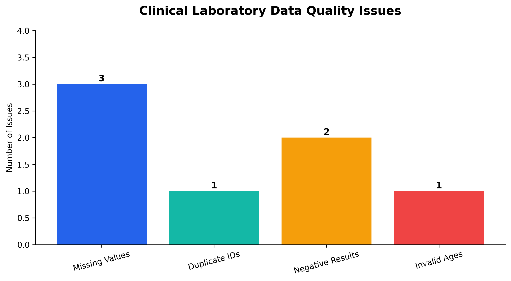
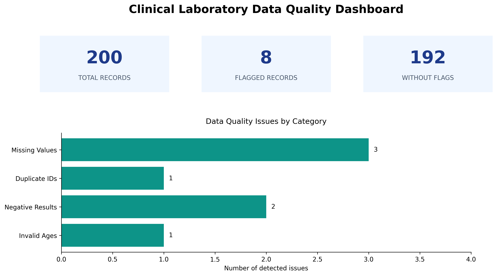
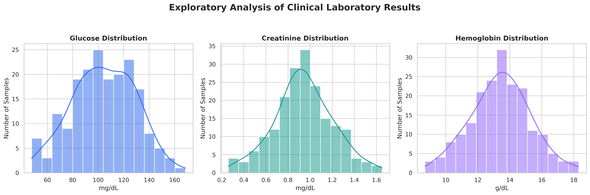
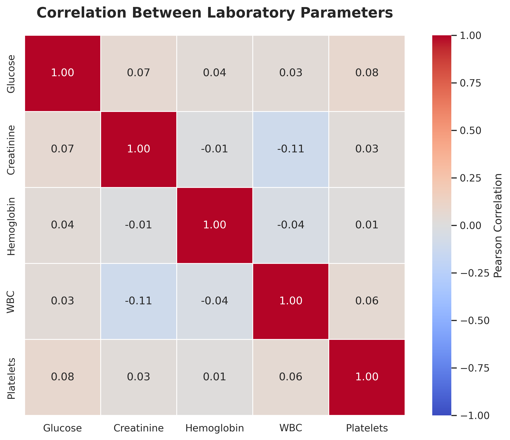

# Clinical Laboratory Data Analysis & Quality Control

## Project Overview

This project demonstrates the application of Python
to clinical laboratory data management, quality
assessment, and exploratory data analysis.

A synthetic dataset of 200 laboratory records was
generated to simulate routine clinical data.

## Objectives

- Identify missing and invalid values
- Detect duplicate sample identifiers
- Perform automated data quality checks
- Analyze laboratory parameter distributions
- Generate descriptive statistics
- Visualize correlations between variables

## Tools & Technologies

- Python
- Pandas
- NumPy
- Matplotlib
- Seaborn
- Google Colab

## Results

The analysis identified:

- 3 missing values
- 2 negative laboratory results
- 1 duplicated sample identifier
- 1 invalid age

A total of 8 records were flagged for review,
while 192 passed the implemented quality checks.

## Skills Demonstrated

- Clinical Data Management
- Data Quality Assessment
- Data Validation
- Exploratory Data Analysis
- Data Visualization
- Scientific Data Interpretation

## Data Disclaimer

All data are synthetic and were generated
exclusively for educational and portfolio purposes.
No real patient information was used.

This project does not provide clinical diagnoses
or validated medical interpretations.

## Data Visualizations

### Data Quality Assessment

### Clinical Data Dashboard

### Laboratory Parameter Distributions

### Correlation Analysis

